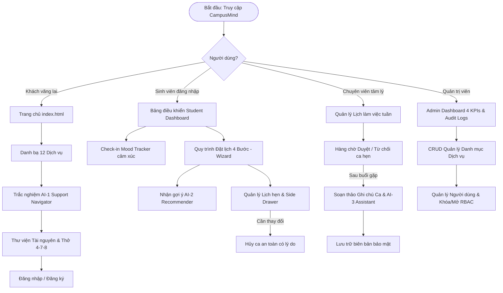

# 🌿 CampusMind — Hệ Thống Điều Phối Hỗ Trợ Sức Khỏe Tinh Thần Sinh Viên

> **Học phần:** Phát triển ứng dụng Web cơ bản — CSE122  
> **Đề tài:** BTL-02 · Lĩnh vực: Sức khỏe tinh thần / Wellbeing học đường  
> **Khoa Công nghệ Thông tin — Trường Đại học Thủy Lợi (TLU)**  
> **Nhóm thực hiện:** Nhóm 02 (3 sinh viên) ** Chu Hữu Đăng ** Vũ Hồng Phúc ** Nguyễn Thái Bảo
> **Quy chuẩn tuân thủ:** [CSE122 Hướng Dẫn Thực Hiện BTL](docs/project-proposal.md) (Phần 9 & Phụ lục E)  
> **Cổng vào ứng dụng:** [`index.html`](index.html) · **Showcase 3 Viewports:** [`showcase.html`](showcase.html)
> > **Đường dẫn triển khai (Live Deployment):** [https://vuhongphuc1297.github.io/cse122-campusmind-team02/](https://vuhongphuc1297.github.io/cse122-campusmind-team02/)

---

## 1. Ngữ Cảnh (Context)

Sinh viên trong môi trường đại học hiện đại phải đối mặt với áp lực gia tăng từ nhiều phía: cường độ thi cử dồn dập, khối lượng đồ án lớn, thay đổi môi trường sống khi xa gia đình, bất đồng phòng trọ và sự mông lung trong định hướng nghề nghiệp. Sức khỏe tinh thần (*Wellbeing*) là nền tảng cốt lõi ảnh hưởng trực tiếp đến kết quả học tập và sự an toàn của sinh viên.

Trường Đại học Thủy Lợi (TLU) hiện đã bố trí Phòng tham vấn tâm lý (P.204 Nhà A1) cùng các câu lạc bộ hỗ trợ sinh viên. Tuy nhiên, sự kết nối giữa sinh viên và các nguồn lực hỗ trợ còn rời rạc, phân tán và thụ động. Nền tảng **CampusMind** ra đời nhằm số hóa toàn diện quy trình điều phối, xây dựng chiếc cầu nối an toàn, bảo mật và thân thiện cho sinh viên toàn trường.

---

## 2. Phát Biểu Vấn Đề (Problem Statements)

Hệ thống giải quyết triệt để 4 vấn đề nhức nhối trong công tác hỗ trợ tâm lý sinh viên (P1–P4):

* **P1. Thông tin dịch vụ phân tán:** Sinh viên gặp khó khăn khi tìm kiếm danh mục dịch vụ tham vấn chính xác, đáng tin cậy và không nắm được lịch trực thực tế của chuyên viên.
* **P2. Rào cản định kiến & Bối rối khi chọn dịch vụ:** E ngại bị kỳ thị (*stigma*) khiến sinh viên rụt rè; khó tự nhận diện mức độ căng thẳng của bản thân để chọn đúng hình thức: tham vấn 1-1, tham gia workshop hay tự thực hành trị liệu.
* **P3. Đặt lịch và hủy lịch thủ công, chậm trễ:** Việc đăng ký qua biểu mẫu giấy hoặc email rời rạc gây chậm trễ, dễ trùng lịch, hủy lịch phút chót và thiếu cam kết bảo mật danh tính sinh viên.
* **P4. Quá tải điều phối & Thiếu số liệu vận hành:** Chuyên viên mất nhiều thời gian xếp lịch thủ công, thiếu công cụ lưu trữ biên bản chuẩn hóa (*Session Notes*). Ban Giám hiệu và Phòng Công tác Sinh viên thiếu bảng điều khiển thời gian thực để đánh giá nhu cầu sức khỏe tinh thần toàn trường.

---

## 3. Mục Tiêu Dự Án (Objectives)

Hệ thống đặt ra 7 mục tiêu định lượng và định tính (O1–O7):

* **O1. Cổng điều phối tập trung:** Xây dựng cổng thông tin thống nhất, chuẩn hóa hành trình người dùng từ khám phá, sàng lọc, đặt hẹn đến đánh giá sau tham vấn.
* **O2. Đầy đủ 4 vai trò:** Thiết kế hoàn chỉnh giao diện cho Khách, Sinh viên, Chuyên viên và Quản trị viên, đảm bảo luồng nghiệp vụ khép kín (*end-to-end*).
* **O3. Triển khai CRUD thực chất:** Vận hành đầy đủ các thao tác Tạo, Đọc, Sửa, Xóa/Hủy/Ẩn trên các thực thể cốt lõi gắn liền vòng đời trạng thái nghiệp vụ.
* **O4. Tương tác JavaScript thuần sâu sắc:** 100% chức năng tìm kiếm, lọc đa tiêu chí, chuyển bước Wizard, Side Drawer, Modal xác nhận, đếm từ và Form Validation được viết bằng Vanilla JS ES6+.
* **O5. Lưu trữ dữ liệu bền vững (Client-side Persistence):** Tích hợp LocalStorage Central Engine và bộ dữ liệu hạt giống phong phú, bảo toàn dữ liệu sau khi F5 và đồng bộ đa tab.
* **O6. Bộ 3 trợ lý AI Human-in-the-loop:** Triển khai chu trình 6 bước AI UX: AI-1 (Support Navigator), AI-2 (Resource Recommender), và AI-3 (Counselor Summary Assistant).
* **O7. Làm việc nhóm chuẩn công nghiệp:** Tuân thủ Git Flow phân nhánh lát cắt dọc, commit chuẩn Conventional Commits, kiểm thử Responsive đa thiết bị và quay video OBS minh chứng có mặt sinh viên.

---

## 4. Các Vai Trò Người Dùng (User Roles & Permissions)

| Vai Trò | Người Dùng Mẫu | Mã Định Danh | Trách Nhiệm & Quyền Hạn Trọng Tâm | Giao Diện Nền Tảng Phụ Trách |
| :--- | :--- | :---: | :--- | :--- |
| **1. Khách** *(Visitor)* | *Khách vãng lai* | — | **Read-only**: Tìm hiểu dịch vụ, cẩm nang thư viện, hồ sơ chuyên gia, làm trắc nghiệm AI-1, liên hệ Hotline khẩn cấp. | [`index.html`](index.html)<br>[`pages/visitor-service-directory.html`](pages/visitor-service-directory.html)<br>[`pages/visitor-resource-library.html`](pages/visitor-resource-library.html)<br>[`pages/visitor-counselor-detail.html`](pages/visitor-counselor-detail.html) |
| **2. Sinh viên** *(Student)* | **Vũ Hồng Phúc** | `2551060661` | **CRUD Lịch cá nhân**: Theo dõi Dashboard 4 KPIs, ghi nhận Mood Tracker, đặt lịch 4 bước, mở Side Drawer xem ca hẹn, hủy ca có lý do. | [`pages/student-dashboard.html`](pages/student-dashboard.html)<br>[`pages/student-booking.html`](pages/student-booking.html)<br>[`pages/student-appointments.html`](pages/student-appointments.html)<br>[`pages/profile.html`](pages/profile.html)<br>[`pages/register.html`](pages/register.html) |
| **3. Chuyên viên** *(Counselor)* | **TS. Nguyễn Minh Hà** | `GV0042` | **Quản trị ca trực & Hồ sơ**: Cài đặt slot trực tuần Thứ 2 - Thứ 7, duyệt/từ chối ca hẹn sinh viên, soạn biên bản lâm sàng kết hợp AI-3. | [`pages/counselor-schedule.html`](pages/counselor-schedule.html)<br>[`pages/counselor-appointment-queue.html`](pages/counselor-appointment-queue.html)<br>[`pages/counselor-session-note.html`](pages/counselor-session-note.html) |
| **4. Quản trị viên** *(Admin)* | **Chu Hữu Đăng** | `ADM001` | **Toàn quyền hệ thống**: Giám sát KPIs vận hành & Audit Logs, CRUD 12 dịch vụ Wellbeing, quản lý tài khoản/khóa mở user, đổi quyền RBAC. | [`pages/admin-dashboard.html`](pages/admin-dashboard.html)<br>[`pages/admin-service-management.html`](pages/admin-service-management.html)<br>[`pages/admin-user-management.html`](pages/admin-user-management.html)<br>[`pages/403.html`](pages/403.html)<br>[`pages/404.html`](pages/404.html) |

---

## 5. Luồng Người Dùng (User Flows)



* **Luồng 1 (Khách):** Tiếp cận thông tin không rào cản $\rightarrow$ Định hướng nhu cầu bằng AI-1 $\rightarrow$ Tạo niềm tin trước khi đặt hẹn.
* **Luồng 2 (Sinh viên):** Đánh giá cảm xúc hàng ngày $\rightarrow$ Đặt lịch bảo mật 4 bước $\rightarrow$ Theo dõi trạng thái ca hẹn minh bạch qua Side Drawer.
* **Luồng 3 (Chuyên viên):** Thiết lập khung giờ trực $\rightarrow$ Sàng lọc ca hẹn tiếp nhận $\rightarrow$ Soạn biên bản lâm sàng với AI-3.
* **Luồng 4 (Quản trị viên):** Giám sát thời gian thực $\rightarrow$ Điều tiết danh mục 12 dịch vụ $\rightarrow$ Kiểm soát bảo mật tài khoản người dùng.

---

## 6. Bảng Kiểm Kê Màn Hình (Screen Inventory)

Hệ thống gồm 17 màn hình nền tảng chuẩn hóa (12 màn hình nghiệp vụ 4 vai trò + 5 màn hình dùng chung) tuân thủ đúng tài liệu kiểm toán [`docs/screen-inventory.md`](docs/screen-inventory.md):

| STT | Vai Trò | Tên Giao Diện | Tên Tệp HTML | Thao Tác Nghiệp Vụ / Trạng Thái | Tính Năng AI | SV Phụ Trách | Nhánh Git Phụ Trách |
| :---: | :--- | :--- | :--- | :--- | :---: | :---: | :--- |
| **01** | Khách | Service Directory | [`pages/visitor-service-directory.html`](pages/visitor-service-directory.html) | R (Xem, Tìm kiếm từ khóa, Lọc 5 danh mục) | — | **SV1** | `feature/visitor-services` |
| **02** | Khách | Resource Library | [`pages/visitor-resource-library.html`](pages/visitor-resource-library.html) | R (Đọc cẩm nang, Đồng hồ thở 4-7-8 tương tác) | ✦ AI-2 | **SV1** | `feature/visitor-resources` |
| **03** | Khách | Counselor Detail | [`pages/visitor-counselor-detail.html`](pages/visitor-counselor-detail.html) | R (Xem hồ sơ chuyên gia, bảng lịch trực tuần) | — | **SV1** | `feature/visitor-counselor` |
| **04** | Sinh viên | Student Dashboard | [`pages/student-dashboard.html`](pages/student-dashboard.html) | R (4 KPIs cá nhân, Mood Tracker tương tác) | ✦ AI-2 | **SV2** | `feature/student-dashboard` |
| **05** | Sinh viên | Booking Wizard | [`pages/student-booking.html`](pages/student-booking.html) | C/R (Đặt lịch 4 bước, Validation đa bước) | ✦ AI-1 | **SV2** | `feature/student-booking` |
| **06** | Sinh viên | Appointments | [`pages/student-appointments.html`](pages/student-appointments.html) | R/U/D (Bộ lọc 5 tab, Side Drawer, Hủy ca) | — | **SV2** | `feature/student-appointments` |
| **07** | Chuyên viên | Counselor Schedule | [`pages/counselor-schedule.html`](pages/counselor-schedule.html) | C/R/U/D (Bật/tắt ca trực, thêm slot mới) | — | **SV3** | `feature/counselor-schedule` |
| **08** | Chuyên viên | Appointment Queue | [`pages/counselor-appointment-queue.html`](pages/counselor-appointment-queue.html) | R/U (Hàng chờ duyệt ca, từ chối kèm lý do) | — | **SV3** | `feature/counselor-queue` |
| **09** | Chuyên viên | Session Note | [`pages/counselor-session-note.html`](pages/counselor-session-note.html) | C/R/U (Đếm từ tự động, lưu nháp, Failure test) | ✦ AI-3 | **SV3** | `feature/counselor-note` |
| **10** | Quản trị | Admin Dashboard | [`pages/admin-dashboard.html`](pages/admin-dashboard.html) | R (4 KPIs toàn trường, biểu đồ công suất, Audit Logs) | — | **SV3** | `feature/admin-dashboard` |
| **11** | Quản trị | Service Management | [`pages/admin-service-management.html`](pages/admin-service-management.html) | C/R/U/D (CRUD 12 dịch vụ, Archive/Active, Modal) | — | **SV3** | `feature/admin-services` |
| **12** | Quản trị | User Management | [`pages/admin-user-management.html`](pages/admin-user-management.html) | C/R/U/D (Lọc vai trò, Khóa/Mở, Đổi quyền RBAC) | — | **SV3** | `feature/admin-users` |
| **13** | Dùng chung | Landing Page | [`index.html`](index.html) | R (Hero Banner TLU, 4 lối vào dịch vụ) | — | **SV1** | `feature/landing-page` |
| **14** | Dùng chung | Login | [`pages/login.html`](pages/login.html) | R (Đăng nhập chuẩn, 1-Click Role Switch) | — | **SV1** | `feature/auth-login` |
| **15** | Dùng chung | Register | [`pages/register.html`](pages/register.html) | C (Đăng ký tài khoản sinh viên có validation) | — | **SV2** | `feature/auth-register` |
| **16** | Dùng chung | Profile & Settings | [`pages/profile.html`](pages/profile.html) | R/U (Xem và cập nhật thông tin cá nhân) | — | **SV2** | `feature/user-profile` |
| **17** | Dùng chung | Error 403 & 404 | [`pages/403.html`](pages/403.html) & [`pages/404.html`](pages/404.html) | R (Route Guard từ chối truy cập & Not Found an toàn) | — | **SV3** | `feature/error-pages` |

---

## 7. Tính Năng AI (AI Features)

Hệ thống triển khai trọn vẹn 3 tính năng AI mô phỏng theo quy trình 6 bước **Human-in-the-loop** chuẩn quốc tế:

1. **AI-1: Support Navigator (Định hướng dịch vụ thông minh):**
   - *Vị trí:* Tích hợp trên [`pages/visitor-service-directory.html`](pages/visitor-service-directory.html) & [`pages/student-booking.html`](pages/student-booking.html).
   - *Cơ chế:* Bộ 4 câu hỏi trắc nghiệm tâm lý học đường sàng lọc mức độ lo âu $\rightarrow$ Trích xuất từ khóa $\rightarrow$ Khớp với danh mục 12 dịch vụ và chuyên gia phù hợp.
   - *Minh bạch (Explainability):* Hiển thị 3 luận điểm giải thích lý do đề xuất, nút Làm lại và Hotline khẩn cấp `1900 6012`.
2. **AI-2: Resource Recommender (Gợi ý tài nguyên tự học cá nhân hóa):**
   - *Vị trí:* [`pages/visitor-resource-library.html`](pages/visitor-resource-library.html), [`pages/student-dashboard.html`](pages/student-dashboard.html), [`pages/student-booking.html`](pages/student-booking.html).
   - *Cơ chế:* Phân tích cảm xúc từ Mood Tracker và lý do tham vấn $\rightarrow$ Gợi ý bài tập thở 4-7-8, audio thiền buông thư hoặc cẩm nang giấc ngủ.
3. **AI-3: Counselor Summary Assistant (Trợ lý biên tập ghi chú lâm sàng):**
   - *Vị trí:* [`pages/counselor-session-note.html`](pages/counselor-session-note.html).
   - *Cơ chế:* Phân tích ghi chép thô $\rightarrow$ Tạo tóm tắt chuẩn mực 3 câu $\rightarrow$ Trích xuất danh sách 3 hành động kế tiếp (*Action Items*). Chuyên viên có toàn quyền chỉnh sửa trước khi lưu vào hồ sơ.
   - *Xử lý ngoại lệ:* Có công tắc giả lập lỗi thất bại (*Failure Test switch*) khi ghi chép dưới 25 từ để chứng minh khả năng xử lý ngoại lệ theo Barem BTL.

---

## 8. Công Nghệ (Technology Stack)

* **Cấu trúc giao diện:** HTML5 ngữ nghĩa chuẩn W3C (`<header>`, `<nav>`, `<main>`, `<section>`, `<article>`, `<aside>`, `<footer>`).
* **Hệ thống tạo kiểu:** CSS3 Variables kết hợp Tailwind CSS CDN Tokens:
  - 8 Token màu trị liệu: *Sage (`#3B7A57`), Deep Sage (`#1F4E38`), Amber AI (`#D97706`), Clay Alert (`#C25E4A`), Paper Background (`#FAF8F5`), Ink Primary (`#1C2826`), Sand Border (`#E6E1DA`), Mint Soft (`#E8F3EE`)*.
  - Phông chữ chuẩn mực: `Fraunces` (tiêu đề trang trọng) + `Be Vietnam Pro` (nội dung sắc nét).
* **Xử lý tương tác:** Vanilla JavaScript thuần (ES6+ Module), không phụ thuộc framework nặng, không lỗi CORS.
* **Lưu trữ dữ liệu:** LocalStorage Central Database (`CampusData` trong [`js/data.js`](js/data.js)), khởi tạo tự động 12 dịch vụ, 4 chuyên gia, 6 lịch hẹn mẫu.
* **Bảo mật học đường:** Cơ chế chống tấn công XSS tự động (`CampusCommon.escapeHTML`), Route Guard phân quyền RBAC ([`js/auth.js`](js/auth.js)).

### 📂 Cấu Trúc Kho Lưu Trữ Chuẩn Hóa

```text
cse122-campusmind-team02_demo/
├── README.md                           # Báo cáo tổng quan dự án (Chuẩn Phụ lục E)
├── index.html                          # Landing Page & 4 Lối vào Dịch vụ
├── showcase.html                       # Showcase trình diễn 3 khung nhìn (Responsive)
├── docs/                               # Tài liệu chuẩn hóa đạt chuẩn Barem Vấn đáp
│   ├── project-proposal.md             # Thuyết minh bài toán P1-P4, O1-O7 & Mô hình thực thể
│   ├── screen-inventory.md             # Bảng kiểm kê 17 màn hình (12 cột kiểm toán)
│   ├── roles-and-features.md           # Đặc tả chi tiết 4 vai trò & ma trận chức năng
│   ├── team-assignment.md              # Bảng phân công Vertical Slice 3 sinh viên
│   ├── ai-usage-report.md              # Báo cáo minh bạch sử dụng AI & cam kết học thuật
│   └── obs-evidence.md                 # Danh mục biên bản minh chứng video OBS
├── design/                             # Tài liệu thiết kế UI/UX
│   ├── figma-link.txt                  # Đường dẫn chính thức dự án Figma
│   └── mockups/                        # 24 bản vẽ Mockup giao diện chi tiết
├── pages/                              # Toàn bộ 17 màn hình nghiệp vụ độc lập
│   ├── visitor-service-directory.html  # SV1: Danh bạ dịch vụ
│   ├── visitor-resource-library.html   # SV1: Thư viện tài nguyên & Thở 4-7-8
│   ├── visitor-counselor-detail.html   # SV1: Hồ sơ chuyên gia
│   ├── login.html                      # SV1: Đăng nhập & 1-Click Role Switch
│   ├── student-dashboard.html          # SV2: Bảng điều khiển sinh viên
│   ├── student-booking.html            # SV2: Đặt lịch 4 bước
│   ├── student-appointments.html       # SV2: Quản lý lịch hẹn & Side Drawer
│   ├── register.html                   # SV2: Đăng ký tài khoản sinh viên
│   ├── profile.html                    # SV2: Hồ sơ cá nhân & Cài đặt
│   ├── counselor-schedule.html         # SV3: Lịch trực tuần chuyên viên
│   ├── counselor-appointment-queue.html# SV3: Hàng chờ duyệt ca hẹn
│   ├── counselor-session-note.html     # SV3: Ghi chú ca tư vấn & AI-3
│   ├── admin-dashboard.html            # SV3: Bảng điều phối vận hành toàn trường
│   ├── admin-service-management.html   # SV3: CRUD quản lý danh mục dịch vụ
│   ├── admin-user-management.html      # SV3: Quản lý người dùng & RBAC
│   ├── 403.html                        # SV3: Cảnh báo từ chối truy cập RBAC
│   └── 404.html                        # SV3: Trang thông báo Not Found
├── assets/                             # Tài nguyên dùng chung
│   ├── data/                           # Tệp dữ liệu khởi tạo JSON (Services, Users, Appointments...)
│   ├── icons/                          # Bộ icon Lucide SVG chuẩn
│   └── images/                         # Logo trường, avatar chuyên gia và sinh viên
├── css/                                # Hệ thống tạo kiểu
│   ├── styles.css                      # 8 Design Tokens, Utility Classes & A11y
│   ├── style.css                       # Bố cục cơ bản
│   └── responsive.css                  # Tối ưu hóa Desktop / Tablet / Mobile
└── js/                                 # Module hóa JavaScript
    ├── api.js                          # Trừu tượng hóa truy vấn dữ liệu (Adapter)
    ├── main.js                         # Khởi tạo toàn trang & Icon bootstrapper
    └── modules/                        # Các module nghiệp vụ cốt lõi
        ├── data.js                     # LocalStorage Central Engine & Hạt giống dữ liệu
        ├── auth.js                     # Quản lý phiên đăng nhập RBAC & Route Guard
        ├── common.js                   # Floating toolbar, Toast, Modal, XSS Sanitize
        └── ai-engine.js                # Động cơ mô phỏng AI-1, AI-2, AI-3
```

---

## 9. Thành Viên Nhóm (Team Members)

> Nhóm làm việc theo mô hình cộng tác bình đẳng (*không phân nhóm trưởng*), mỗi sinh viên chịu trách nhiệm độc lập và trọn vẹn một lát cắt dọc (Vertical Slice):

| STT | Họ và Tên | Mã Sinh Viên | Vai Trò & Phân Hệ Phụ Trách | Email Liên Hệ |
| :---: | :--- | :---: | :--- | :--- |
| 1 | **Chu Hữu Đăng** | `2551060595` | **Cổng Khách (Visitor)** & Nền tảng Giao diện chung | `chuhuudang2007@gmail.com` |
| 2 | **Vũ Hồng Phúc** | `2551060661` | **Sinh viên (Student)** & Dữ liệu LocalStorage / AI Phía Client | `vuphucpa@gmail.com` |
| 3 | **Nguyễn Thái Bảo** | `2551060584` | **Chuyên viên (Counselor)** & **Quản trị (Admin)** & RBAC | `loxuyen89576@gmail.com` |

---

## 10. Phân Công Công Việc (Task Assignment - Vertical Slices)

Dự án áp dụng triệt để nguyên tắc **Lát cắt dọc (Vertical Slice)** theo Mục 3.11 Barem BTL CSE122: Mỗi sinh viên tự chịu trách nhiệm hoàn chỉnh luồng từ Phân tích $\rightarrow$ Mockup $\rightarrow$ HTML $\rightarrow$ CSS $\rightarrow$ JS $\rightarrow$ Dữ liệu $\rightarrow$ Responsive $\rightarrow$ Git Branch/PR $\rightarrow$ OBS:

```text
SV1: Chu Hữu Đăng — Khách (Visitor) & Landing Page & Nền tảng Giao diện chung
├── 5 Màn hình: index.html, visitor-service-directory.html, visitor-resource-library.html, visitor-counselor-detail.html, pages/login.html
├── Trục ngang: Hệ thống Design Tokens 8 màu (css/styles.css), Header/Footer, Demo dock nổi, A11y WCAG AA
└── Đóng góp: 33.33%

SV2: Vũ Hồng Phúc — Sinh viên (Student) & Quản lý Tài khoản & Động cơ Dữ liệu LocalStorage
├── 5 Màn hình: student-dashboard.html, student-booking.html, student-appointments.html, register.html, profile.html
├── Trục ngang: LocalStorage CRUD Engine (js/data.js), Seed Data, Động cơ AI-1 & AI-2, Đồng bộ đa tab, Xuất CSV
└── Đóng góp: 33.33%

SV3: Nguyễn Thái Bảo — Chuyên viên (Counselor) & Quản trị viên (Admin) & Bảo mật RBAC
├── 7 Màn hình: counselor-schedule.html, counselor-appointment-queue.html, counselor-session-note.html, admin-dashboard.html, admin-service-management.html, admin-user-management.html, 403.html, 404.html
├── Trục ngang: Phân quyền RBAC (js/auth.js), Trợ lý AI-3, Điều phối Showcase 3 Viewports, Giải quyết xung đột Merge PR
└── Đóng góp: 33.33%
```

---

## 11. Quy Trình Git (Git Flow & Conventional Commits)

* **Chiến lược phân nhánh:**
  - `main`: Nhánh ổn định cao nhất, chỉ chứa phiên bản phát hành cuối cùng.
  - `dev`: Nhánh tích hợp chung của cả nhóm. Mọi tính năng đều phải xuất phát và hợp nhất vào `dev`.
  - `feature/<ten-tinh-nang>`: Nhánh làm việc độc lập của từng sinh viên.
* **Quy chuẩn thông điệp Commit (Conventional Commits):**
  - `feat(...)`: Thêm màn hình hoặc tính năng mới.
  - `fix(...)`: Sửa lỗi giao diện, form validation hoặc xử lý dữ liệu.
  - `docs(...)`: Cập nhật tài liệu, bảng kiểm kê hoặc báo cáo.
  - `style(...)`: Định dạng CSS, căn chỉnh khoảng cách, màu sắc.
  - `refactor(...)`: Tối ưu hóa mã JavaScript nhưng không làm đổi tính năng.
* **Quy trình chống xung đột (Zero Conflict Rule):**
  Trước khi tạo Pull Request, sinh viên bắt buộc kéo code mới nhất từ `dev` về máy cục bộ và kiểm thử trơn tru:
  ```bash
  git checkout dev
  git pull origin dev
  git checkout feature/<ten-nhanh>
  git merge dev
  # Giải quyết xung đột local nếu có, test chạy thử bằng Live Server
  git push origin feature/<ten-nhanh>
  ```

---

## 12. Figma / Canva (Design System & Wireframes)

* **Liên kết Figma chính thức:** [Xem tệp liên kết design/figma-link.txt](design/figma-link.txt)
* **Thư mục Mockups giao diện chi tiết:** [`design/mockups/`](design/mockups/)
* **Đặc tả Design Tokens:** Quy định rõ ràng trong [`css/styles.css`](css/styles.css) gồm bảng mã màu tương phản đạt chuẩn WCAG 2.1 AA (tỷ lệ tương phản chữ/nền tối thiểu 4.5:1), hệ thống khoảng cách 8px grid, bo góc chuẩn và huy hiệu trạng thái (*Status Pills*).

---

## 13. Demo (Hướng Dẫn Cài Đặt & Tài Khoản Thử Nghiệm)

### 🚀 Hướng Dẫn Cài Đặt & Chạy Ứng Dụng

Dự án được xây dựng hoàn toàn bằng **Web Frontend tiêu chuẩn**, không cần cài đặt Node.js hay cơ sở dữ liệu nặng:

* **Cách 1: Sử dụng VS Code Live Server (Khuyên dùng)**
  1. Mở thư mục `cse122-campusmind-team02_demo` trong Visual Studio Code.
  2. Cài đặt extension **Live Server** (`RitwickDey.LiveServer`).
  3. Nhấp chuột phải vào [`index.html`](index.html) chọn **"Open with Live Server"**.
  4. Trình duyệt tự động mở tại `http://127.0.0.1:5500/index.html`.
* **Cách 2: Chạy qua `npx serve`**
  ```bash
  npx serve .
  ```
  Truy cập: `http://localhost:3000`
* **Cách 3: Mở trực tiếp bằng trình duyệt (Zero-setup `file:///`)**
  Nhấp đúp chuột trực tiếp vào file [`index.html`](index.html) hoặc bất kỳ trang nào trong thư mục `pages/`.

### 🔑 Tài Khoản Thử Nghiệm 4 Vai Trò (Tích hợp Thanh Demo Nổi)

Hệ thống có sẵn **Thanh công cụ Demo nổi (Floating Demo Dock)** ở góc dưới bên phải màn hình giúp chuyển đổi tức thì giữa 4 vai trò mà không cần gõ mật khẩu:

| Vai Trò Thử Nghiệm | Tên Người Dùng | Email Đăng Nhập | Mật Khẩu | Mã Định Danh |
| :--- | :--- | :--- | :---: | :---: |
| **1. Khách** *(Visitor)* | *Khách vãng lai* | *(Không cần đăng nhập)* | — | — |
| **2. Sinh viên** *(Student)* | **Vũ Hồng Phúc** | `vuphucpa@gmail.com` | `123456` | `2551060661` |
| **3. Chuyên viên** *(Counselor)* | **TS. Nguyễn Minh Hà** | `ha.nm@tlu.edu.vn` | `123456` | `GV0042` |
| **4. Quản trị viên** *(Admin)* | **Chu Hữu Đăng** | `chuhuudang2007@gmail.com` | `admin123` | `ADM001` |

---

## 14. Minh Chứng OBS (OBS Evidence)

Theo đúng quy định tại [`docs/obs-evidence.md`](docs/obs-evidence.md), 100% video đều có webcam hiển thị rõ khuôn mặt sinh viên, thuyết minh thao tác nghiệp vụ, F12 Console/LocalStorage và giải thích code trong VS Code:

Chu Hữu Đăng: https://www.youtube.com/playlist?list=PLNlHyTK2Id38

Vũ Hồng Phúc: https://www.youtube.com/playlist?list=PLDlwkZyNE0Uk

Nguyễn Thái Bảo: https://youtube.com/playlist?list=PLR__gNxW7it4&si=vKlC-CM3aaCAOEKA

---

## 15. Khai Báo Sử Dụng AI (AI Usage Declaration)

Tuân thủ nghiêm ngặt **Phụ lục F** của Barem hướng dẫn BTL CSE122 theo [`docs/ai-usage-report.md`](docs/ai-usage-report.md):

* **Công cụ:** Google Gemini, Claude 3.5 Sonnet, GitHub Copilot.
* **Câu lệnh (Prompt) tiêu biểu:**
  1. *"Xây dựng bộ câu hỏi định hướng 4 bước cho tính năng AI-1 Support Navigator dành cho sinh viên gặp lo âu học đường, tuân thủ nguyên tắc không chẩn đoán bệnh lý y khoa."*
  2. *"Viết hàm chuyển bước Wizard 4 bước bằng JavaScript thuần, kiểm tra hợp lệ validation ở từng bước và lưu dữ liệu vào LocalStorage."*
  3. *"Thiết kế thuật toán tóm tắt biên bản tham vấn tâm lý 3 câu ngắn gọn và trích xuất 3 hành động kế tiếp cho chuyên gia, có công tắc giả lập lỗi ngoại lệ khi dưới 25 từ."*
* **AI sinh ra:**
  - Khung mã HTML/CSS ban đầu, thuật toán ẩn hiện tab cơ bản, mẫu dữ liệu JSON hạt giống ban đầu.
* **Sinh viên chỉnh sửa & làm chủ:**
  - **SV1 (Chu Hữu Đăng):** Thay thế các mã CSS cố định `px` của AI bằng hệ thống CSS Variables tương đối (`rem`), sửa lỗi tràn màn hình (overflow) trên mobile 320px, chỉnh sửa toàn bộ nội dung câu hỏi AI-1 cho phù hợp văn hóa sinh viên TLU.
  - **SV2 (Vũ Hồng Phúc):** Gỡ bỏ các lệnh `alert()` sơ sài do AI tạo ra (tránh bị trừ điểm barem), thay bằng thông báo lỗi inline trực quan và Toast notification; tự tay xây dựng mô-đun `js/data.js` kết nối `localStorage` bền vững.
  - **SV3 (Nguyễn Thái Bảo):** Tái cấu trúc cơ chế phân quyền RBAC (`js/auth.js`), thêm công tắc thử nghiệm lỗi AI-3 (*Failure Test switch*), xây dựng trang `showcase.html` kiểm thử 3 thiết bị.
* **Cách kiểm chứng:**
  - Kiểm thử trực tiếp trên trình duyệt, mở F12 Console & Application tab kiểm tra key `campusmind_*`.
  - Thực hiện kiểm thử biên (nhập để trống, nhập ký tự đặc biệt XSS, nhập chuỗi quá dài).
* **Điều học được:**
  - AI là trợ thủ tuyệt vời để phác thảo ý tưởng và tăng tốc độ viết boilerplate, nhưng sinh viên phải là người nắm vững kiến trúc dữ liệu, hiểu rõ luồng người dùng và trực tiếp làm chủ từng dòng mã lệnh khi bảo vệ trước Hội đồng vấn đáp.
